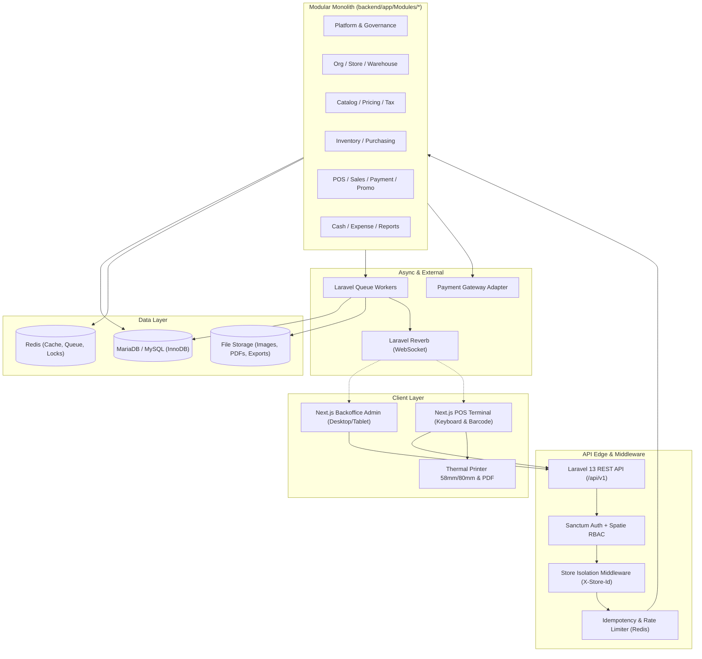

# System & Modular Architecture

| Metadata | Value |
| :--- | :--- |
| **Document ID** | `DOC-002` |
| **Version** | `1.0.0` |
| **Status** | `Approved Baseline` |
| **Last Updated** | `2026-11-19` |
| **Author** | Principal Software Architect (AI Agent) |

---

## 1. High-Level System Architecture

Aplikasi dibangun sebagai monorepo dengan **Backend Modular Monolith (Laravel 13)** di `backend/` dan **Frontend Next.js (App Router)** di `frontend/`.



---

## 2. Bounded Contexts & 27 Backend Modules

| Bounded Context | Modules | Primary Responsibility |
| :--- | :--- | :--- |
| **Platform & Governance** | `Core`, `IAM`, `Notification`, `AuditLog`, `Settings` | Shared primitives (Money, Quantity, ApiResponse, Idempotency), Auth/RBAC, Notifikasi, Audit Trail, System Settings. |
| **Organization & Topology** | `Organization`, `Store`, `Warehouse` | Company profile, outlet/cabang, timezone, operating hours, gudang fisik/virtual. |
| **Catalog & Pricing** | `Product`, `Category`, `Brand`, `Unit`, `Tax` | Master produk (standard, variant, bundle, service, non-stock), konversi satuan, barcode, store pricing, riwayat harga, pajak. |
| **Inventory & Supply Chain** | `Inventory`, `StockAdjustment`, `StockTransfer`, `Supplier`, `Purchasing` | Stock ledger, row-level locking, adjustment, transfer antar gudang, opname, supplier, PO, GRN, invoice, payment, return. |
| **Commerce & POS** | `Customer`, `POS`, `Sales`, `Payment`, `Promotion` | Customer & loyalty, POS checkout, hold/resume, sales lifecycle, split payment, payment gateway abstraction, promo engine. |
| **Cash & Finance** | `CashManagement`, `Expense` | Cash register sessions, cash in/out, shift reconciliation, expense categories & approvals. |
| **Intelligence** | `FinancialReporting`, `Analytics` | Role-based dashboards, operational/financial reports, async Excel/CSV/PDF exports. |

---

## 3. Standard Module Structure

Setiap modul di `backend/app/Modules/<ModuleName>/` mengikuti struktur seragam:

```text
backend/app/Modules/<ModuleName>/
├── Actions/                 # Single-purpose use cases (e.g., CompleteCheckoutAction)
├── Contracts/               # Public interfaces for cross-module communication
├── Data/                    # Readonly PHP 8.5 DTOs
├── Domain/                  # Enums, Value Objects, Domain Exceptions
├── Events/                  # Immutable domain events
├── Http/
│   ├── Controllers/         # Thin HTTP adapters (no business logic)
│   ├── Requests/            # FormRequest validation & authorization
│   └── Resources/           # Consistent JSON API Resources
├── Listeners/               # Cross-module event subscribers
├── Models/                  # Eloquent models with strict casts & relations
├── Policies/                # Permission + Store Isolation policies
├── Services/                # Domain services & orchestrators
├── Database/
│   ├── Migrations/
│   ├── Factories/
│   └── Seeders/
├── Routes/
│   └── api.php
├── Tests/
│   ├── Unit/
│   └── Feature/
└── <ModuleName>ServiceProvider.php
```

### Module Communication Rules
1. **No Direct Cross-Module Model Writes**: Modul `POS` tidak boleh mengubah tabel `inventory_stocks` secara langsung; ia memanggil `InventoryStockContract::deduct(...)` di dalam database transaction yang sama.
2. **Async Side Effects via Domain Events**: Audit log, notifikasi low-stock, dan pembaruan cache dashboard dipicu melalui Domain Events (`SaleCompleted`, `StockAdjusted`, `GoodsReceiptConfirmed`).
3. **Thin Controllers, Rich Actions/Services**: Controller hanya menerima `FormRequest`, memanggil satu `Action`/`Service`, dan mengembalikan `ApiResponse` / `JsonResource`.

---

## 4. Frontend Architecture (`frontend/`)

```text
frontend/src/
├── app/
│   ├── (auth)/              # Login & Store Selection
│   ├── (dashboard)/         # Backoffice Layout (Sidebar, Topbar, Dark/Light mode)
│   └── (pos)/               # Fullscreen POS Terminal (Keyboard & Barcode First)
├── components/
│   ├── ui/                  # shadcn/ui primitives
│   └── shared/              # DataTable, ConfirmDialog, EmptyState, Skeleton
├── features/                # Feature-sliced UI (pos, products, inventory, purchasing, sales, cash, reports)
├── hooks/                   # useBarcodeScanner, usePosShortcuts, useActiveStore
├── lib/                     # Axios/Fetch API client, TanStack Query client, Zod schemas, currency formatters
└── stores/                  # Zustand stores (cart, activeStore, registerSession)
```

---

## 5. Monorepo Folder Layout

```text
pos/
├── backend/                 # Laravel 13 Modular Monolith API
├── frontend/                # Next.js TypeScript App
├── docs/                    # Architecture, ERD, API, Business Rules, ADR, Trackers
└── .gitignore
```

---

## Document Track Record

| Version | Date | Phase | Author | Summary of Changes |
| :--- | :--- | :--- | :--- | :--- |
| `1.0.0` | `2026-11-19` | Phase 0 | AI Architect | Initial architecture blueprint covering system diagram, 27-module breakdown, boundary rules, and monorepo structure. |
