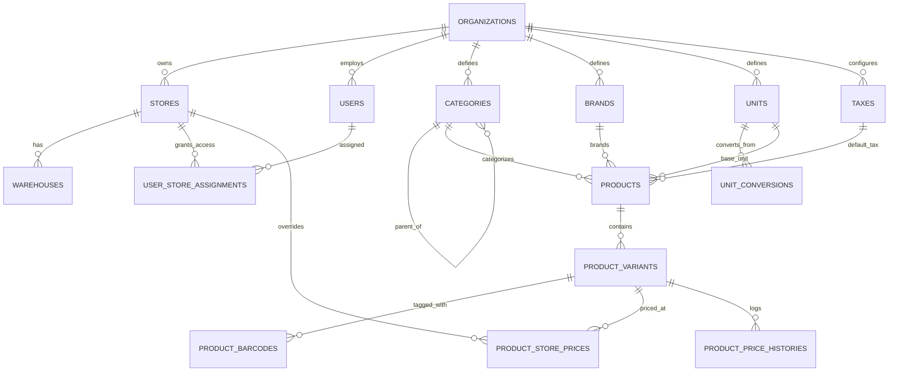
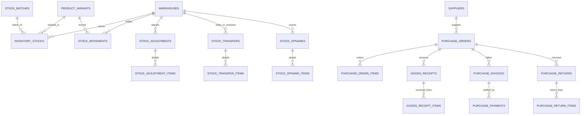
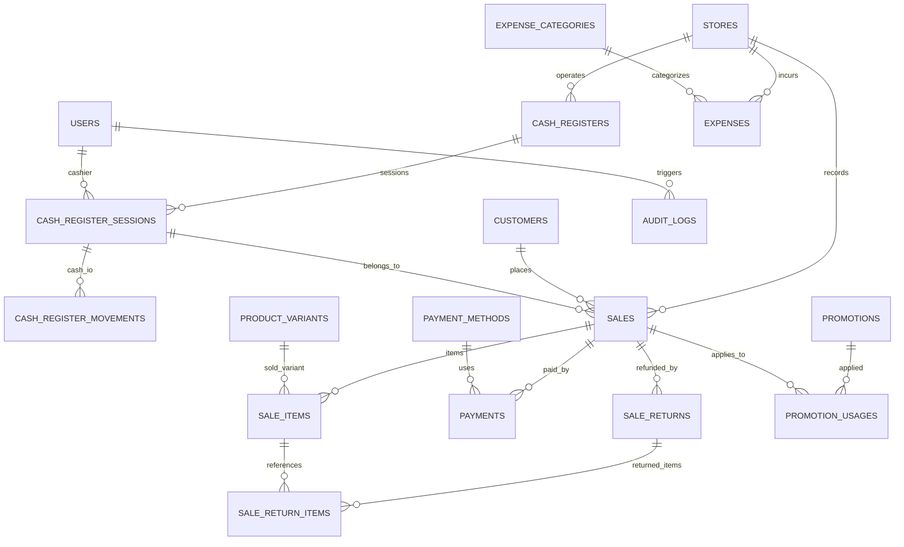

# Entity Relationship Diagram (ERD)

| Metadata | Value |
| :--- | :--- |
| **Document ID** | `DOC-004` |
| **Version** | `1.0.0` |
| **Status** | `Approved Baseline` |
| **Last Updated** | `2026-11-19` |
| **Author** | Database Architect (AI Agent) |

---

## 1. Organization, IAM & Catalog ERD

---

## 2. Inventory & Purchasing ERD

---

## 3. POS, Sales, Payments, Cash & Finance ERD

---

## Document Track Record

| Version | Date | Phase | Author | Summary of Changes |
| :--- | :--- | :--- | :--- | :--- |
| `1.0.0` | `2026-11-19` | Phase 0 | AI Database Architect | Initial ERD split across 3 readable domain diagrams (IAM/Catalog, Inventory/Purchasing, POS/Finance). |
