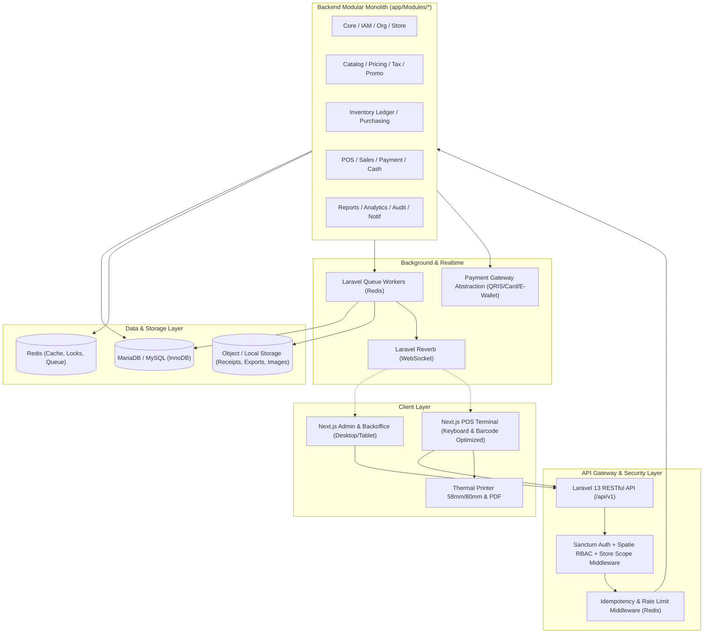
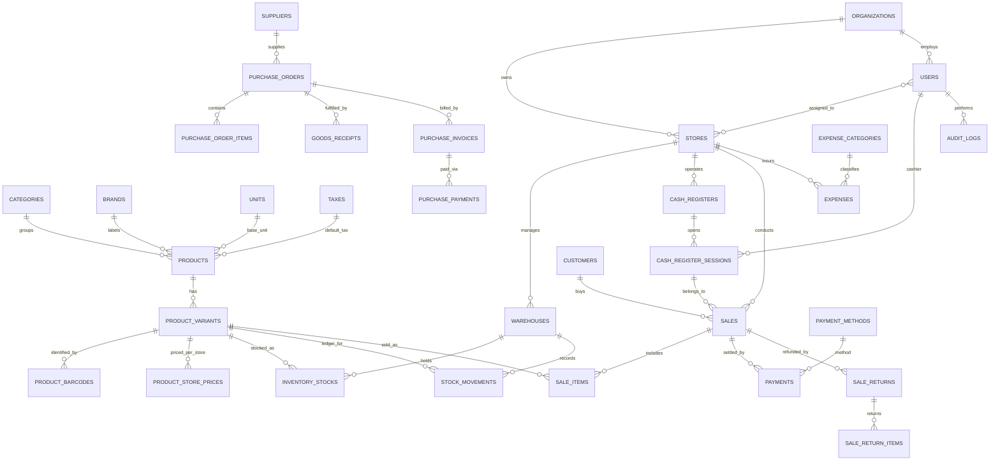

# Enterprise Point of Sales (POS) — Architectural Blueprint & Implementation Plan

## Goal Description

Dokumen ini merupakan hasil analisis menyeluruh tahap awal (**Phase 0 — Architecture & Discovery**) untuk membangun aplikasi **Enterprise Point of Sales (POS)** yang modern, modular, scalable, secure, dan siap dikembangkan menjadi ERP penuh tanpa *rewrite*.

Rencana ini disusun setelah memeriksa kondisi codebase eksisting di `/home/hambali/development/pos` (Laravel 13.17, PHP ^8.3, Pest 5.2, Larastan Level 7, Laravel Pint, Livewire 4.1 starter kit, serta integrasi **PowerHuman SSO** yang sudah ada).

Setelah dokumen ini disetujui, langkah eksekusi pertama adalah menerbitkan seluruh dokumentasi resmi di direktori `docs/` (11 dokumen wajib + tracker, ADR, feature checklist) sebelum masuk ke **Phase 1 — Foundation**.

---

## User Review Required

> [!IMPORTANT]
> **Temuan Codebase Eksisting di `/home/hambali/development/pos`**
> 1. **Laravel 13.17** sudah terinisialisasi di root repository menggunakan `laravel/blank-livewire-starter-kit` (dengan `livewire/livewire ^4.1` dan `livewire/blaze ^1.0`).
> 2. Terdapat integrasi **PowerHuman SSO** (`app/Http/Controllers/Auth/PowerHumanSsoController.php`, `routes/web.php`, `tests/Feature/Auth/PowerHumanSsoTest.php`, dan env `POWERHUMAN_*`).
> 3. Database default saat ini masih `sqlite` di `.env.example` dan `phpunit.xml`, sedangkan target produksi adalah **MariaDB / MySQL (InnoDB)** dengan row-level locking (`SELECT ... FOR UPDATE`).
> 4. Belum ada direktori frontend **Next.js**.

---

## Open Questions (Ambiguitas & Keputusan Arsitektur)

> [!WARNING]
> Mohon konfirmasi poin-poin berikut sebelum kita mengunci ADR (Architecture Decision Records) dan memulai Phase 1:

1. **Struktur Repository (Monorepo vs Root Laravel)**:
   - Opsi A *(Recommended)*: Pertahankan Laravel di root atau pindahkan ke `backend/`, dan letakkan aplikasi Next.js di `frontend/` dalam satu monorepo agar konsisten dengan CI/CD dan pengembangan bersama. Apakah Anda memilih **(A1) Monorepo `backend/` + `frontend/`** atau **(A2) Laravel tetap di root + `frontend/` di subfolder**?
2. **Nasib Integrasi PowerHuman SSO & Livewire Starter**:
   - Apakah **PowerHuman SSO** harus dipertahankan sebagai salah satu metode login (terintegrasi ke modul IAM bersama login lokal Sanctum), atau akan dihapus?
   - Karena frontend target adalah **Next.js + shadcn/ui**, apakah `livewire/livewire` dan `livewire/blaze` boleh dihapus pada Phase 1 agar backend murni RESTful API?
3. **Authentication Strategy (Sanctum vs Passport)**:
   - Rekomendasi: **Laravel Sanctum** (token-based / SPA cookie-based, ringan, native untuk Next.js first-party + mobile/POS terminal). Gunakan **Passport** hanya jika di masa depan aplikasi ini bertindak sebagai OAuth2 Provider untuk integrasi pihak ketiga. Mana yang Anda pilih?
4. **Multi-Tenancy Model (Single-Database Shared Schema vs Multi-Database)**:
   - Rekomendasi: **Single Database dengan kolom `organization_id` dan `store_id`** + global/explicit scoping & policy checks. Lebih mudah untuk reporting lintas outlet dan migrasi ERP. Setuju?
5. **Inventory Valuation Method (HPP / COGS)**:
   - Metode apa yang menjadi standar default: **Moving Average Cost (MAC)** *(Recommended untuk retail umum)*, **FIFO**, atau dapat dikonfigurasi per organisasi?
6. **Offline POS Capability**:
   - Apakah POS harus mendukung *offline-first* (IndexedDB + sync queue saat internet putus) pada Phase 5, atau cukup *online-first* dengan *optimistic UI* & *auto-retry* terlebih dahulu?
7. **Pembulatan Mata Uang & Multi-Currency**:
   - Apakah transaksi default menggunakan **IDR (Rupiah)** dengan pembulatan khusus (mis. pembulatan ke ratusan terdekat untuk tunai), dan apakah dukungan *multi-currency* diperlukan sejak Phase 1 atau cukup disimpan kolom `currency_code` (default `IDR`) untuk kesiapan masa depan?

---

## 1. Analisis Requirement & Identifikasi Domain Bisnis

Berdasarkan spesifikasi, aplikasi terbagi menjadi **7 Bounded Contexts** yang membawahi **27 Modul Backend**:

| Bounded Context | Modul Backend (27 Modul) | Tanggung Jawab Utama |
| :--- | :--- | :--- |
| **Platform & Governance** | 1. Core, 2. IAM, 25. Notification, 26. Audit Log, 27. System Settings | Cross-cutting concerns, auth/RBAC, multi-store guard, event logging, notifikasi, konfigurasi global. |
| **Organization & Topology** | 3. Organization, 4. Store Management, 5. Warehouse Management | Struktur perusahaan, outlet/cabang, gudang, jam operasional, timezone, konfigurasi pajak & kasir per store. |
| **Catalog & Pricing** | 6. Product, 7. Category, 8. Brand, 9. Unit of Measurement, 20. Tax Management | Master produk (standard, variant, bundle, service, non-stock), konversi satuan, multi-barcode, tier harga & riwayat harga, konfigurasi pajak. |
| **Inventory & Supply Chain** | 10. Inventory, 11. Stock Adjustment, 12. Stock Transfer, 13. Supplier, 15. Purchasing | Ledger stok (`stock_movements`), locking stok, opname, transfer antar gudang/outlet, PO, Goods Receipt, Purchase Invoice, Return, & Payment. |
| **Commerce & POS** | 14. Customer, 16. Point of Sales, 17. Sales Management, 18. Payment Management, 19. Discount & Promotion | Kasir cepat (barcode/keyboard), cart, hold/resume, checkout idempotent, split payment, gateway abstraction, struk thermal/PDF, retur & refund, promo engine. |
| **Cash & Finance** | 21. Cash Management, 22. Expense Management | Cash register session (open/close/reconciliation), cash in/out, kasir shift, pencatatan & approval biaya operasional. |
| **Intelligence** | 23. Financial Reporting, 24. Dashboard & Analytics | Dashboard per role, laporan penjualan/inventory/purchasing/keuangan, export Excel/CSV/PDF berbasis query teroptimasi & background job. |

---

## 2. System Architecture

Arsitektur menggunakan **Modular Monolith** untuk backend (Laravel 13) dan **SPA/SSR Frontend** terpisah (Next.js App Router), didukung MariaDB/MySQL (InnoDB), Redis (Cache + Queue + Rate Limit), dan Laravel Reverb (opsional untuk realtime alert/dashboard).



### Alasan Keputusan Arsitektur
- **Modular Monolith (bukan Microservices)**: Transaksi POS memerlukan konsistensi ACID ketat antara *Sales*, *Inventory*, *Payment*, *Cash Register*, dan *Audit Log*. Database transaction tunggal di InnoDB menjamin konsistensi tanpa kompleksitas *distributed transaction / Saga* yang prematur.
- **Boundary Enforcement**: Komunikasi lintas modul dilakukan melalui **Service Interfaces / Contracts** atau **Domain Events** (mis. `SaleCompleted`, `GoodsReceiptConfirmed`), bukan saling mengakses Model internal modul lain secara sembarangan.

---

## 3. Modular Architecture

Setiap modul di `app/Modules/<ModuleName>/` memiliki struktur standar dan *Service Provider* sendiri yang didaftarkan di `bootstrap/providers.php`:

```text
app/Modules/<ModuleName>/
├── Actions/          # Single-responsibility business use cases (e.g. CompleteCheckoutAction)
├── Contracts/        # Public interfaces untuk komunikasi antar modul
├── Data/             # Readonly DTOs (PHP 8.3) untuk transfer data terstruktur
├── Domain/           # Enums, Value Objects (Money, Quantity), Domain Exceptions
├── Events/           # Domain events (e.g. StockAdjusted, SaleRefunded)
├── Http/
│   ├── Controllers/  # Thin controllers: validasi -> panggil Action/Service -> return Resource
│   ├── Requests/     # Laravel FormRequest + authorization
│   └── Resources/    # Consistent API Resources
├── Listeners/        # Event listeners lintas modul
├── Models/           # Eloquent models dengan strict typing & relasi
├── Policies/         # Granular Spatie Permission + Store Isolation policies
├── Services/         # Domain services / orchestrators
├── Database/
│   ├── Migrations/   # Module-scoped migrations
│   ├── Factories/    # Factories untuk testing
│   └── Seeders/      # Default seeders (roles, permissions, units, dll.)
├── Routes/
│   └── api.php       # Versioned module routes (/api/v1/...)
├── Tests/
│   ├── Unit/
│   └── Feature/
└── <ModuleName>ServiceProvider.php
```

> [!NOTE]
> `phpstan.neon` (Level 7) dan `phpunit.xml` akan dikonfigurasi untuk mencakup `app/Modules/` sehingga static analysis dan test suite otomatis memindai seluruh modul.

---

## 4. Database Design & ERD

### Prinsip Desain Database (MariaDB / MySQL InnoDB)
1. **Strict Numeric Precision**:
   - Semua nilai uang menggunakan `DECIMAL(15, 2)` (tidak pernah `FLOAT` atau `DOUBLE`).
   - Semua kuantitas stok menggunakan `DECIMAL(15, 4)` untuk mendukung satuan pecahan (Kg, Gram, Liter, Meter).
   - Persentase pajak/diskon menggunakan `DECIMAL(7, 4)`.
2. **Multi-Organization & Multi-Store Isolation**:
   - Tabel operasional menyimpan `organization_id` dan `store_id` (serta `warehouse_id` untuk inventory) dengan composite index `(organization_id, store_id, ...)`.
3. **Immutable Transaction Snapshots**:
   - `sale_items`, `purchase_order_items`, `sale_taxes` menyimpan *snapshot* `product_name`, `sku`, `barcode`, `unit_name`, `unit_price`, `cost_price`, `tax_rate`, `discount_amount` pada saat transaksi terjadi.
4. **Ledger-Based Inventory**:
   - `inventory_stocks` menyimpan saldo aktual per `(warehouse_id, product_variant_id, batch_id)` dan dikunci dengan `SELECT ... FOR UPDATE` saat mutasi.
   - `stock_movements` bersifat *append-only* sebagai buku besar (ledger) yang merekam `qty_before`, `qty_change`, `qty_after`, `reference_type`, `reference_id`, `unit_cost`, dan `created_by`.
5. **Idempotency & Auditability**:
   - Tabel `idempotency_keys` mencegah eksekusi ganda pada checkout/payment.
   - Tabel `audit_logs` bersifat *append-only* (tanpa endpoint update/delete) dengan `old_values`, `new_values`, `request_id`, `ip_address`, `user_id`.

### Ringkasan Tabel Utama per Domain (Core Tables)

- **IAM & Organization**: `organizations`, `stores`, `warehouses`, `users`, `user_store_assignments`, `roles`, `permissions`, `model_has_roles`, `model_has_permissions`, `role_has_permissions`.
- **Catalog & Pricing**: `categories`, `brands`, `units`, `unit_conversions`, `taxes`, `products`, `product_variants`, `product_barcodes`, `product_bundles`, `product_store_prices`, `product_price_histories`.
- **Inventory**: `inventory_stocks`, `stock_batches`, `stock_serial_numbers`, `stock_movements`, `stock_adjustments`, `stock_adjustment_items`, `stock_transfers`, `stock_transfer_items`, `stock_opnames`, `stock_opname_items`.
- **Partners**: `suppliers`, `customers`, `customer_groups`, `customer_loyalty_ledgers`.
- **Purchasing**: `purchase_orders`, `purchase_order_items`, `goods_receipts`, `goods_receipt_items`, `purchase_invoices`, `purchase_payments`, `purchase_returns`, `purchase_return_items`.
- **POS, Sales & Payments**: `sales`, `sale_items`, `sale_discounts`, `sale_taxes`, `payments`, `payment_methods`, `sale_returns`, `sale_return_items`, `promotions`, `promotion_rules`, `promotion_usages`.
- **Cash & Expenses**: `cash_registers`, `cash_register_sessions`, `cash_register_movements`, `expense_categories`, `expenses`.
- **Platform**: `audit_logs`, `notifications`, `settings`, `idempotency_keys`.

### Entity Relationship Diagram (Core Business Entities)



---

## 5. Core Business Rules & Data Integrity

1. **Immutability Transaksi**: Transaksi `sales` berstatus `paid`, `partially_refunded`, atau `refunded` **tidak pernah dihapus**. Pembatalan/koreksi dilakukan melalui `sale_returns` atau `void/cancellation` dengan alasan wajib, otorisasi Supervisor/Manager, dan audit log.
2. **Backend-Only Calculation**: Backend **mengabaikan** `subtotal`, `discount_total`, `tax_total`, `grand_total`, dan `unit_price` dari payload frontend (kecuali `price_override` jika user memiliki permission eksplisit `pos.override_price` dan tetap divalidasi terhadap `min_selling_price`).
3. **Concurrency & Anti-Negative Stock**:
   - Saat checkout / stock out / transfer, baris `inventory_stocks` diurutkan berdasarkan `id ASC` (mencegah *deadlock*) lalu dikunci menggunakan `lockForUpdate()` (`SELECT ... FOR UPDATE`) di dalam `DB::transaction()`.
   - Jika `qty_on_hand - qty_reserved < requested_qty` dan konfigurasi `allow_negative_stock = false`, transaksi langsung di-rollback dengan HTTP `422`.
4. **Idempotent Checkout & Payment**:
   - Setiap request `POST /api/v1/pos/transactions` dan `.../complete` wajib membawa header `Idempotency-Key` (UUID v4). Request duplikat dengan key & payload sama mengembalikan response tersimpan tanpa memotong stok atau mencatat pembayaran dua kali.
5. **Split Payment Validation**:
   - Transaksi hanya dapat berubah menjadi `paid` apabila `SUM(confirmed_payments.amount) >= sale.grand_total`. Kembalian (`change_amount`) hanya dihitung dari komponen pembayaran `cash`.
6. **Cash Register Session Integrity**:
   - Kasir wajib memiliki `cash_register_session` berstatus `open` untuk melakukan transaksi POS tunai.
   - Register tidak dapat ditutup apabila masih terdapat transaksi `pending_payment` pada sesi tersebut (atau harus diselesaikan/di-hold/dibatalkan terlebih dahulu).
   - Formula rekonsiliasi:
     - `expected_cash = opening_balance + cash_sales + cash_in - cash_out - cash_refund - cash_expense`
     - `cash_difference = actual_cash - expected_cash`
   - Sesi berstatus `closed` bersifat *immutable*; penyesuaian pasca-tutup wajib melalui *adjustment entry* + permission khusus + audit log.
7. **Refund & Return Guard**:
   - Total kuantitas retur akumulatif untuk setiap `sale_item_id` tidak boleh melebihi `sale_item.quantity`.
   - Retur barang layak jual otomatis menghasilkan `stock_movement` bertipe `sale_return` (stock in); barang rusak dicatat ke status/lokasi rusak tanpa menambah stok layak jual.
8. **Store Isolation**:
   - User tanpa permission `stores.access_all` hanya bisa membaca/menulis data pada `store_id` yang ditugaskan di `user_store_assignments`. Akses lintas outlet diblokir di Middleware + Policy dengan HTTP `403`.
9. **Decimal Arithmetic**:
   - Seluruh kalkulasi finansial di PHP menggunakan `bcmath` (atau Money Value Object berbasis integer minor units / `bcmath`) untuk mencegah *floating-point drift*.

---

## 6. API Architecture

### Standar RESTful API (`/api/v1`)
- **Authentication**: Bearer Token (Sanctum) atau HttpOnly Cookie SPA.
- **Required Headers**: `Accept: application/json`, `X-Store-Id: <store_uuid_or_id>` (konteks outlet aktif), `Idempotency-Key: <uuid>` (wajib pada operasi mutasi finansial/stok).
- **Consistent Response Envelope**:
  ```json
  {
    "success": true,
    "message": "Transaction completed successfully.",
    "data": {},
    "meta": {
      "request_id": "req_01J...",
      "pagination": { "current_page": 1, "per_page": 20, "total": 120, "last_page": 6 }
    }
  }
  ```
- **Error Envelope**:
  ```json
  {
    "success": false,
    "message": "Insufficient stock for SKU-001.",
    "error_code": "INSUFFICIENT_STOCK",
    "errors": { "items.0.quantity": ["Available stock is 2, requested 5."] },
    "meta": { "request_id": "req_01J..." }
  }
  ```
- **Endpoint Groups (Use-Case Oriented)**:
  - `/api/v1/auth/*` (login, logout, refresh, me, switch-store)
  - `/api/v1/organizations`, `/api/v1/stores`, `/api/v1/warehouses`
  - `/api/v1/users`, `/api/v1/roles`, `/api/v1/permissions`
  - `/api/v1/products`, `/api/v1/categories`, `/api/v1/brands`, `/api/v1/units`, `/api/v1/taxes`
  - `/api/v1/inventory` (overview, movements, reconcile, adjustments, transfers, opnames)
  - `/api/v1/suppliers`, `/api/v1/customers`
  - `/api/v1/purchasing/orders`, `/goods-receipts`, `/invoices`, `/payments`, `/returns`
  - `/api/v1/pos/transactions` (create, hold, resume, payments, complete, receipt, void, refund)
  - `/api/v1/cash-register` (open, current, cash-in, cash-out, close, sessions)
  - `/api/v1/promotions`, `/api/v1/expenses`, `/api/v1/reports/*`, `/api/v1/dashboard/*`, `/api/v1/audit-logs`, `/api/v1/notifications`, `/api/v1/settings`
- **API Documentation**: Menggunakan **Dedoc Scramble** untuk auto-generate OpenAPI 3.1 langsung dari FormRequest, Controller, dan API Resource.

---

## 7. Folder Structure (Proposed Monorepo)

*Contoh struktur (opsi A2 — Laravel tetap di root + `frontend/` Next.js, atau dapat dipindahkan ke `backend/` sesuai keputusan Anda):*

```text
pos/
├── app/
│   ├── Modules/                  # 27 Domain Modules (Modular Monolith)
│   │   ├── Core/
│   │   ├── IAM/
│   │   ├── Organization/
│   │   ├── Store/
│   │   ├── Warehouse/
│   │   ├── Product/
│   │   ├── Inventory/
│   │   ├── Purchasing/
│   │   ├── POS/
│   │   ├── Sales/
│   │   ├── Payment/
│   │   ├── CashManagement/
│   │   ├── Promotion/
│   │   ├── Tax/
│   │   ├── Expense/
│   │   ├── Reporting/
│   │   ├── Analytics/
│   │   ├── Notification/
│   │   ├── AuditLog/
│   │   └── Settings/
│   └── Providers/
├── docs/                         # Dokumentasi Arsitektur, ERD, ADR, Roadmap
├── frontend/                     # Next.js (App Router, TypeScript, Tailwind, shadcn/ui)
│   ├── src/
│   │   ├── app/
│   │   │   ├── (auth)/           # Login, Store Selection
│   │   │   ├── (dashboard)/      # Admin Backoffice Layout (Sidebar, Header, Dark/Light)
│   │   │   └── (pos)/            # Dedicated Fullscreen POS Terminal Layout
│   │   ├── components/           # shadcn/ui & shared components
│   │   ├── features/             # Feature-sliced modules (pos, products, inventory, dll.)
│   │   ├── hooks/                # Custom hooks (barcode scanner, keyboard shortcuts)
│   │   ├── lib/                  # API client, TanStack Query, formatters, Zod schemas
│   │   └── stores/               # Zustand stores (POS cart, active store, register session)
├── routes/
├── database/
└── tests/
```

---

## 8. Implementation Roadmap (8 Phases)

| Phase | Fokus Utama | Deliverable & Exit Criteria |
| :--- | :--- | :--- |
| **Phase 0** *(Saat Ini)* | Architecture & Documentation | Persetujuan blueprint ini + pembuatan seluruh file di `docs/` (11 dokumen + ADR + tracker). |
| **Phase 1** | Foundation | Setup MariaDB/Redis, Sanctum, Spatie Permission (10 default roles + granular permissions), Scramble OpenAPI, Core/IAM/Org/Store/User/AuditLog modules, Next.js base layout (Sidebar, Auth, Dark/Light mode). |
| **Phase 2** | Master Data | Categories, Brands, Units (+ conversions), Taxes, Warehouses, Suppliers, Customers, Products (standard, variant, bundle, service, non-stock, multi-barcode, store pricing & price history). |
| **Phase 3** | Inventory | Ledger `stock_movements`, `SELECT FOR UPDATE` locking, Stock Adjustments, Stock Transfers (in-transit + receive), Stock Opname, batch/expiry tracking, rekonsiliasi stok, Inventory reports. |
| **Phase 4** | Purchasing | Purchase Orders (approval workflow), Goods Receipts (partial/full/damaged -> stock in), Purchase Invoices, Purchase Payments, Purchase Returns. |
| **Phase 5** | Point of Sales (Core) | Dedicated POS UI (keyboard/barcode optimized), Cart, Hold/Resume, Idempotent Checkout, Split Payment, Payment Gateway abstraction, Thermal 58mm/80mm & PDF receipt, Sales history & cancellation. |
| **Phase 6** | Financial Management | Cash Register Open/Close, Cash In/Out, Expected vs Actual reconciliation, Sales Returns & Refunds, Expense Management (approval workflow). |
| **Phase 7** | Advanced Features | Promotion & Discount Engine (stacking/priority rules), Loyalty Points, Notification system (DB/Email/Reverb), Role-based Dashboards, Full Reporting + Async Export (Excel/CSV/PDF). |
| **Phase 8** | Quality & Production | Security audit, query/index tuning, 10 Critical Scenario concurrency/integrity tests, OpenAPI verification, Docker/deployment & backup strategy, monitoring. |

---

## 9. Identifikasi Risiko Teknis & Bisnis

| Kategori | Risiko | Dampak | Mitigasi |
| :--- | :--- | :--- | :--- |
| **Concurrency** | Dua kasir menjual 1 stok terakhir bersamaan | Negative stock / overselling | `SELECT ... FOR UPDATE` dengan urutan lock deterministik (`ORDER BY id ASC`) + unit/feature concurrency test. |
| **Network / UX** | Kasir klik "Bayar" 2x saat jaringan lambat | Double charge & double stock deduction | Wajib `Idempotency-Key` di backend + disable button & optimistic lock di frontend. |
| **Financial Integrity** | Floating point error pada diskon/pajak/split payment | Selisih laporan keuangan | `DECIMAL(15,2)` di DB + `bcmath` / Money Value Object di backend. |
| **Security** | Manipulasi harga/diskon/store_id dari DevTools frontend | Kerugian finansial / kebocoran data lintas cabang | Backend selalu re-calculate dari DB + validasi `X-Store-Id` terhadap `user_store_assignments`. |
| **Performance** | Laporan tahunan mengunci tabel transaksi POS aktif | POS melambat saat jam sibuk | Composite indexes, read-optimized summary queries, async queue untuk export besar, cursor pagination. |
| **Scope Creep** | 27 modul terlalu besar jika dibangun serentak | Kualitas menurun & banyak bug regresi | Eksekusi ketat per Phase dengan Definition of Done (migration, validation, policy, Pest test, Larastan Level 7, Pint). |

---

## 10. Proposed Changes (Eksekusi Setelah Blueprint Ini Disetujui)

Setelah Anda menyetujui rencana ini dan menjawab *Open Questions* di atas, tahap eksekusi pertama (melengkapi **Phase 0**) akan membuat dokumentasi resmi di direktori `docs/`:

#### [NEW] `docs/PROJECT_OVERVIEW.md`
#### [NEW] `docs/ARCHITECTURE.md`
#### [NEW] `docs/DATABASE_DESIGN.md`
#### [NEW] `docs/ERD.md`
#### [NEW] `docs/BUSINESS_RULES.md`
#### [NEW] `docs/API_DOCUMENTATION.md`
#### [NEW] `docs/SECURITY.md`
#### [NEW] `docs/DEVELOPMENT_GUIDE.md`
#### [NEW] `docs/TESTING_STRATEGY.md`
#### [NEW] `docs/IMPLEMENTATION_ROADMAP.md`
#### [NEW] `docs/CHANGELOG.md`
#### [NEW] `docs/FEATURE_CHECKLIST.md`
#### [NEW] `docs/PROGRESS_TRACKER.md`
#### [NEW] `docs/KNOWN_ISSUES_AND_FUTURE.md`
#### [NEW] `docs/adr/0001-modular-monolith-architecture.md` (dan ADR kunci lainnya sesuai jawaban Anda)

---

## Verification Plan

### Phase 0 Verification (Dokumentasi)
- Memastikan seluruh 11 dokumen wajib + tracker, feature checklist, dan ADR tersusun konsisten dan saling merujuk tanpa konflik antar-spesifikasi.

### Phase 1–8 Automated Verification Standard
Setiap fitur di tiap fase wajib lulus seluruh check sebelum dinyatakan selesai:
- **Code Style**: `vendor/bin/pint --parallel --test`
- **Static Analysis (Level 7)**: `vendor/bin/phpstan analyse`
- **Automated Tests (Pest 5)**: `php artisan test` (mencakup 10 *Critical Scenarios* pada Phase 3–6)
- **Frontend Check** *(mulai Phase 1)*: `npm run lint && npm run type-check && npm run build` di direktori `frontend/`

---

## Document Track Record

| Version | Date | Phase | Author | Summary of Changes |
| :--- | :--- | :--- | :--- | :--- |
| `1.0.0` | `2026-11-19` | Phase 0 | AI Architect | Initial blueprint created and copied to project `docs/IMPLEMENTATION_PLAN.md`. |
| `1.1.0` | `2026-11-19` | Phase 0 | AI Architect | Approved monorepo fresh-install (`backend/` + `frontend/` + `docs/`), locked recommended architectural decisions into `docs/adr/0001`–`0003`, and completed full Phase 0 documentation suite. |
